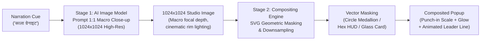
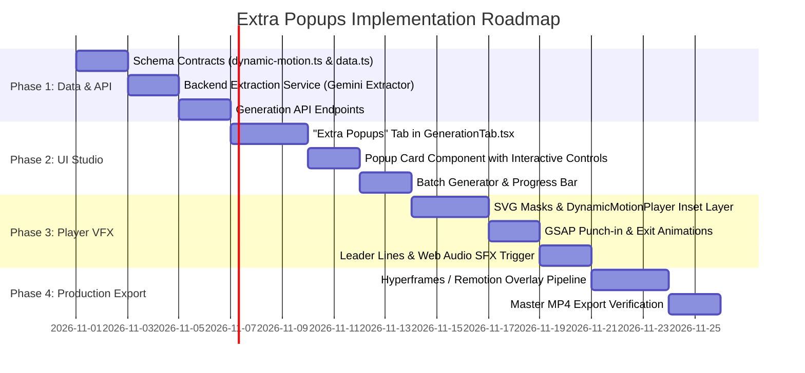

# Extra Popups Architecture & Implementation Plan
## Dynamic Inset Spotlight Assets & Detail Callouts for Retention-Driven Video

- **Target System**: Tubeflow OMS Native (Shorts & Cinematic Video Engine)
- **Status**: Architecture & Design Phase (Pre-Implementation Plan)
- **Version**: 1.0.0
- **Scope**: Data Contracts, Diffusion Macro Pipeline, "Extra Popups" UI Tab, Compositing Engine, and Channel Styles

---

## 1. Executive Summary & Retention Psychology

In short-form vertical video (YouTube Shorts, Instagram Reels, TikTok), viewer drop-off occurs most frequently when visual pacing stalls or when narration describes a specific noun, relic, or detail that the viewer cannot immediately inspect. 

### What is an "Extra Popup"?
An **Extra Popup** (also termed an *Inset Spotlight Asset* or *Visual Detail Callout*) is a high-resolution, secondary visual asset generated on demand that animates onto the screen inside a stylized frame (such as an ornate circular medallion, tactical hexagon, or museum glass plaque) over the main scene video or background.

```
+------------------------------------------+
|  MAIN SCENE (Video / Cinematic Zoom)    |
|                                          |
|         +----------------------+         |
|         | EXTRA POPUP (1:1)    |         |
|         | [ Sacred Gold Frame ]|         |
|         |  Carved Black Granite|         |
|         |  Macro Detail Inset  |         |
|         +----------------------+         |
|                     \                    |
|                      \ Leader Line       |
|                       * [ Sanctum Wall ] |
|                                          |
|  "The sanctum is carved from monolithic  |
|   resonant black granite..."             |
+------------------------------------------+
```

### Why it Boosts Viewer Retention
1. **Micro-Visual Evidence**: When the script mentions *"glass of water in the desert"*, *"black resonant granite"*, or *"divine arrows of Lord Rama"*, the viewer doesn't just hear it—they get instant visual confirmation in micro-detail.
2. **Pattern Interrupt**: Every 3 to 5 seconds, an animated detail pop resets the viewer's subconscious attentional decay curve.
3. **Information Density**: It gives the video a high-budget documentary feel (similar to BBC, Vox, or National Geographic motion graphics).

---

## 2. The AI Diffusion Model Challenge & The 2-Stage Macro Solution

### The Core Problem
Diffusion models (FLUX.1 Schnell, SDXL, Midjourney, Imagen) are trained to generate complete scene compositions. If prompted to generate a *"tiny 150px icon of a glass of water"* or *"small cube size temple stone"*, they fail in one of three ways:
1. They hallucinate wide-angle clutter with an indistinguishable small object in the corner.
2. They render low-resolution artifacts or messy borders.
3. They fail to understand coordinate sizing in a 9:16 or 16:9 canvas.

### The 2-Stage Macro Pipeline



#### Stage 1: Full-Resolution 1:1 Macro Generation
The system requests a standard **1024×1024 (1:1 square)** image from the configured model (Cloudflare FLUX.1 Schnell, Local Stable Diffusion, or Pollinations). 

The prompt engineering engine wraps the subject in strict **Studio Macro Directives**:
```
"Isolated macro studio close-up of [SUBJECT], centered composition, extreme micro-detail, 
cinematic 8k photograph, razor-sharp focus on texture, dramatic side rim lighting, 
clean dark studio backdrop with shallow depth of field, high contrast, zero background clutter"
```

*Examples:*
- **Desert Water Glass**: *"Isolated macro studio close-up of a clear crystal glass filled with ice-cold water, condensation droplets dripping down the glass surface, dramatic warm sunlight refraction, centered composition, shallow depth of field, dark cinematic studio backdrop, 8k photorealistic."*
- **Ancient Dharma Temple Granite**: *"Macro close-up of ancient monolithic black granite stone with intricate sacred Vedic carving, deep obsidian sheen, glistening micro-fissures, warm golden temple oil lamp rim lighting, extreme tactile texture, 8k high-fidelity architectural study."*
- **Divine Weapon (God's Arrow)**: *"Sacred mythological divine arrow tip (Astra) forged from glowing celestial gold and meteoric bronze, emitting ethereal solar embers, sacred Sanskrit glyphs etched along the shaft, isolated macro studio shot, cinematic rim lighting, 8k epic."*

#### Stage 2: Geometric Masking & Downsampling
The player and video rendering engines do not display the 1024×1024 raw square. Instead:
- The image is loaded into an SVG `<clipPath>` or CSS masked container.
- High-resolution downsampling produces super-sampled, razor-sharp anti-aliased visual insets without blur.
- Outer borders, rotating gold runes, tactical HUD brackets, or glowing drop-shadows are rendered around the mask via SVG/CSS.
- Optional transparent background pass (via rembg / AI alpha cutout) can be toggled for free-floating objects.

---

## 3. UI/UX Design: The "Extra Popups" Generation Tab

The user interface will be integrated seamlessly into [`src/components/generation/GenerationTab.tsx`](file:///Users/laheri/Documents/name/new-oms-native/src/components/generation/GenerationTab.tsx).

### Tab Navigation Bar
A new third tab button is added to the generation sub-nav:

```tsx
<div role="tablist" aria-label="Generation type" className="flex items-center gap-1 rounded-xl bg-surface2/60 p-1">
  <button id="generation-images-tab" ...>
    <ImageIcon className="h-4 w-4" /> Images & videos
  </button>
  <button id="generation-audio-tab" ...>
    <Music className="h-4 w-4" /> Audio
  </button>
  <button id="generation-extra-popups-tab" ...>
    <Sparkles className="h-4 w-4" /> Extra Popups
  </button>
</div>
```

### Layout of the "Extra Popups" Studio Screen

```
+----------------------------------------------------------------------------------------------------+
| EXTRA POPUPS STUDIO                                                                                 |
| Manage and generate macro visual detail insets that pop over your main scene footage               |
+----------------------------------------------------------------------------------------------------+
| [ ⚡ Scan Narration for Popups ]   [ ➕ Add Custom Popup ]   [ 🚀 Generate All (4 Pending) ]        |
| Provider: [ Cloudflare FLUX.1 Schnell ▼ ]    Preset: [ Ultra Detail Macro ▼ ]                       |
+----------------------------------------------------------------------------------------------------+
|                                                                                                    |
| +--- SCENE 1 (00:00 - 00:06) --------------------------------------------------------------------+ |
| | [Thumbnail]  Cue: "सुदर्शन चक्र" (At 00:02.4)                                                   | |
| |              Title: Divine Sudarshana Discus                                                    | |
| |              Shape: [ Circle Medallion ▼ ]   Position: [ Top-Right ▼ ]   SFX: [ sacred_bell ▼ ] | |
| |              Prompt: "Macro close-up of spinning golden Sudarshana Chakra with 108 razor teeth"| |
| |              Status: [ Ready ]  [ 👁 View ]  [ 🔄 Regenerate ]  [ 🗑 Delete ]                     | |
| +------------------------------------------------------------------------------------------------+ |
|                                                                                                    |
| +--- SCENE 2 (00:06 - 00:14) --------------------------------------------------------------------+ |
| | [Empty Box]  Cue: "काला ग्रेनाइट" (At 00:09.1)                                                  | |
| |              Title: Monolithic Black Granite                                                    | |
| |              Shape: [ Museum Glass Plaque ▼ ]  Position: [ Bottom-Right ▼ ]  SFX: [ whoosh ▼ ]| |
| |              Prompt: "Macro tactile study of polished black temple granite with Vedic glyphs"   | |
| |              Status: [ Pending ]  [ 🎨 Generate Now ]  [ ✏️ Edit Prompt ]                         | |
| +------------------------------------------------------------------------------------------------+ |
|                                                                                                    |
+----------------------------------------------------------------------------------------------------+
```

### Core Features in the "Extra Popups" Tab
1. **One-Click Script Scanner (`scanScriptForPopups`)**:
   - Parses the narration of all scenes using Gemini.
   - Identifies high-value nouns (materials, weapons, relics, biological specimens, instruments, documents).
   - Generates recommended 1:1 macro prompts, suggested shapes, positions, and cue timestamps.
2. **Independent Generation & Re-Roll**:
   - Creators can generate or regenerate individual popup assets without touching the main scene video or audio.
3. **Interactive Shape & Placement Customizer**:
   - Choose frame styles: `Circle Medallion`, `Tactical Hexagon`, `Museum Glass Card`, `Magnifying Loupe`, or `Cutout`.
   - Set screen placement with instant preview (`top-right`, `bottom-right`, `top-left`, `bottom-left`, `center-right`).
4. **Direct Asset Upload**:
   - Creators can upload existing PNGs or SVGs directly to use as popup assets.

---

## 4. Data Contracts & Schema Specification

### 4.1 Schema Extension in `packages/editing-contracts/src/dynamic-motion.ts`

```ts
import { z } from 'zod';

export const ExtraPopupShape = z.enum([
  'circle_medallion',   // Ornate ring or circular portal
  'tactical_hexagon',  // Sci-fi / tech angled polygon
  'museum_glass_card', // Rounded translucent card with label
  'magnifying_loupe',  // Scientific/detective circular lens with handle
  'cutout_relic',      // Free-floating subject with transparent background
]);
export type ExtraPopupShapeType = z.infer<typeof ExtraPopupShape>;

export const ExtraPopupPlacement = z.enum([
  'top-right',
  'top-left',
  'bottom-right',
  'bottom-left',
  'center-right',
  'center-left',
]);
export type ExtraPopupPlacementType = z.infer<typeof ExtraPopupPlacement>;

export const ExtraPopupAssetSchema = z.strictObject({
  id: z.string().min(1),
  sceneIndex: z.number().int().min(0),
  cueWord: z.string().min(1),             // Noun or phrase triggering the popup
  cueOffsetSec: z.number().min(0).default(1.0), // Delay from scene start
  durationSec: z.number().min(1.0).max(10.0).default(3.5),
  title: z.string().min(1).max(100),       // Clean English/Hindi label
  subtitle: z.string().max(200).optional(), // Detail note e.g. "Mohs Hardness: 7"
  prompt: z.string().min(5),              // 1:1 Macro prompt
  negativePrompt: z.string().optional(),
  shape: ExtraPopupShape.default('circle_medallion'),
  placement: ExtraPopupPlacement.default('top-right'),
  scalePercent: z.number().min(15).max(60).default(30), // Viewport width %
  imageUrl: z.string().optional(),        // Local or remote URL
  maskUrl: z.string().optional(),          // Optional alpha mask
  sfx: z.enum(['whoosh', 'sacred_bell', 'telemetry_chirp', 'energy_hum', 'impact_boom', 'none']).default('whoosh'),
  status: z.enum(['pending', 'generating', 'ready', 'error']).default('pending'),
  error: z.string().optional(),
});
export type ExtraPopupAsset = z.infer<typeof ExtraPopupAssetSchema>;
```

### 4.2 Script Model Extension in `src/data.ts`
```ts
export interface Script {
  // Existing fields...
  id: string;
  name: string;
  narration?: string;
  scenePlan?: ScenePlan;
  imagePrompts?: string[];
  generatedImages?: GeneratedImage[];
  
  // NEW FIELD:
  extraPopups?: ExtraPopupAsset[];
}
```

---

## 5. AI Extraction Engine (Prompt Engineering)

A dedicated backend service (`server/src/services/extra-popups-extractor.ts`) invokes Gemini with structured output to analyze scene narration and visual intent.

### System Prompt Directive for Extraction
```
You are an expert short-form video creative director specializing in retention-driven visual annotations.
Your task is to analyze the narration and visual context of each scene in a video script and identify 1-2 high-impact physical nouns, relics, materials, or objects that would captivate the viewer if shown as a macro detail popup.

Criteria for Selection:
1. Physicality: Must be a concrete object, weapon, material, relic, liquid, or biological specimen (NOT an abstract concept).
2. Detail Value: Showing a macro close-up must reveal fascinating texture, craftsmanship, or scientific structure.
3. Perfect Synchronization: Align with the exact cue phrase where the narrator speaks the noun.

Output Format: JSON array of ExtraPopupAsset suggestions.
```

### Prompt Transformation Matrix

| Spoken Narration Noun | Extracted Concept | Frame Shape | Generated 1:1 Macro Prompt |
| :--- | :--- | :--- | :--- |
| *"मरुस्थल में एक घूंट पानी"* (Water in desert) | Crystal Ice Water Glass | `circle_medallion` | `Macro studio close-up of a condensation-dripping crystal glass with clear ice water, amber desert sunlight backlighting, razor-sharp droplet details, centered, dark background, 8k photograph` |
| *"मंदिर का काला ग्रेनाइट"* (Temple Black Granite) | Monolithic Black Granite | `museum_glass_card` | `Macro geological study of monolithic carved black granite, polished obsidian luster with sacred geometric chisel marks, golden oil sheen, warm diya rim light, 8k tactile texture` |
| *"अमोघ बाण"* (Infallible Divine Arrow) | Celestial Astra Tip | `circle_medallion` | `Macro close-up of an ornate mythological divine arrow tip forged from radiant gold and celestial bronze, sacred runes glowing along edges, floating solar embers, dark studio isolation` |
| *"टाइटेनियम मिश्र धातु"* (Titanium Alloy Armor) | Honeycomb Tactical Metal | `tactical_hexagon` | `Macro engineering photograph of brushed aerospace titanium alloy with hexagonal laser micro-welds, matte gunmetal sheen, cyan telemetry laser line, tactical industrial studio lighting` |

---

## 6. Compositing, Animation & Sound Engine

The compositing engine operates across two environments:
1. **Real-time Web Studio Preview**: Rendered dynamically in [`src/components/preview/DynamicMotionPlayer.tsx`](file:///Users/laheri/Documents/name/new-oms-native/src/components/preview/DynamicMotionPlayer.tsx).
2. **Headless Video Export Pipeline**: Rendered via Hyperframes / Remotion / FFmpeg overlay pipeline into the final master MP4.

### 6.1 Animation Lifecycle (GSAP Timeline)
Every Extra Popup follows a 3-act lifecycle:

```
0.0s                  0.4s                                   (End - 0.3s)       End
 +---------------------+---------------------------------------+------------------+
 |   ACT I: ENTRANCE   |             ACT II: FLOAT             |   ACT III: EXIT  |
 | Elastic Punch-in    | Micro 3D Parallax Gyro Drift          | Smooth Scale-down|
 | Scale: 0 -> 1.06-> 1| Subtle pulse glow / rotating ring     | Opacity -> 0     |
 | Leader Line Draws   | Viewers inspect micro-detail          |                  |
 | SFX Fires           |                                       |                  |
 +---------------------+---------------------------------------+------------------+
```

```javascript
// GSAP Animation Sequence
const tl = gsap.timeline();

// Act I: Punch-In Entrance
tl.fromTo(popupRef.current, 
  { scale: 0, opacity: 0, rotationY: 25 },
  { scale: 1, opacity: 1, rotationY: 0, duration: 0.45, ease: "back.out(1.8)" }
);

// Act I (Parallel): Leader Line Stroke Draw
tl.fromTo(lineRef.current,
  { strokeDashoffset: lineLength },
  { strokeDashoffset: 0, duration: 0.35, ease: "power2.out" },
  "-=0.3"
);

// Act II: Subtle Living Drift (Float)
tl.to(popupRef.current, {
  y: "-=6px",
  duration: 2.0,
  ease: "sine.inOut",
  yoyo: true,
  repeat: -1
});

// Act III: Exit Dissolve
tl.to(popupRef.current, {
  scale: 0.85,
  opacity: 0,
  duration: 0.3,
  ease: "power2.in"
}, `+=${duration - 0.75}`);
```

### 6.2 SVG Frame Styling & Leader Lines

#### Circle Medallion Frame (Ancient Dharma)
```html
<svg class="extra-popup-frame" viewBox="0 0 400 400">
  <defs>
    <!-- Clip Path for the 1:1 Generated Image -->
    <clipPath id="circleClip">
      <circle cx="200" cy="200" r="170" />
    </clipPath>
    <!-- Radial Gold Glow -->
    <radialGradient id="goldGlow" cx="50%" cy="50%" r="50%">
      <stop offset="85%" stop-color="#f59e0b" stop-opacity="0" />
      <stop offset="100%" stop-color="#f59e0b" stop-opacity="0.8" />
    </radialGradient>
  </defs>

  <!-- Pulsing Ambient Glow -->
  <circle cx="200" cy="200" r="185" fill="none" stroke="#f59e0b" stroke-width="2" opacity="0.4" class="pulse-ring" />
  
  <!-- Rotating Vedic Rune Ring -->
  <circle cx="200" cy="200" r="176" fill="none" stroke="#d97706" stroke-width="3" stroke-dasharray="12 6" class="spin-slow" />
  
  <!-- Inset AI-Generated Macro Image -->
  <image href="{imageUrl}" x="30" y="30" width="340" height="340" clip-path="url(#circleClip)" preserveAspectRatio="xMidYMid slice" />
  
  <!-- Inner Glass Bevel Highlight -->
  <circle cx="200" cy="200" r="170" fill="none" stroke="rgba(255,255,255,0.4)" stroke-width="2" />
</svg>
```

#### Leader Line & Text Badge
A vector leader line with an animated circular node extends from the popup toward the subject on screen, accompanied by a clean typography badge:
```
+--------------------------+
|  [ IMAGE INSET ]         |
|                          |
+--------------------------+
  |
  +-- [ BLACK GRANITE ] --------* (Sanctum Wall Focal Point)
      Monolithic • Mohs 7
```

### 6.3 Procedural Sound Effects Synchronization
When the popup punches in at `cueOffsetSec`, the zero-latency Web Audio API synthesizer generates the corresponding audio event:
- **`sacred_bell`**: 880 Hz fundamental with golden metallic decay (Ancient Dharma).
- **`telemetry_chirp`**: Rapid 1800 Hz -> 2400 Hz dual frequency chirp (Rule Zero).
- **`whoosh`**: Bandpass-filtered white noise sweep from 400 Hz to 2800 Hz (Against the Odds).

---

## 7. Channel-Specific Styling Presets

| Channel Profile | Frame Shape | Border & Glow Palette | Leader Line Style | Audio SFX |
| :--- | :--- | :--- | :--- | :--- |
| **Ancient Dharma** | Ornate Circle Medallion | Deep Amber Gold (`#f59e0b`), Saffron (`#ea580c`), Warm Diya Bloom | Golden filament, lotus node terminator | `sacred_bell` or `energy_hum` |
| **Rule Zero** | Tactical Angle Hexagon | Cyber Cyan (`#06b6d4`), Carbon Black (`#0f172a`), Laser Blue | Grid-aligned orthogonal 90° line with crosshair node | `telemetry_chirp` |
| **Against the Odds** | Museum Archival Plaque | Brushed Brass (`#d4af37`), Dark Leather (`#1c1917`), Parchment | Thin ivory hair-spring line with compass needle node | `whoosh` or `impact_boom` |

---

## 8. Phased Implementation Roadmap



### Phase 1: Contracts & Backend Engine
- Define `ExtraPopupAsset` and `ExtraPopupShape` schemas in `@tubeflow/editing-contracts`.
- Create `server/src/services/extra-popups-engine.ts` for AI extraction and prompt macro generation.
- Implement `/api/scripts/:id/extra-popups/detect` and `/api/scripts/:id/extra-popups/generate` routes.

### Phase 2: Generation Screen UI
- Add the `"Extra Popups"` sub-tab to `src/components/generation/GenerationTab.tsx`.
- Build `src/components/generation/ExtraPopupsContent.tsx` with full visual editing, re-rolling, and batch generation controls.

### Phase 3: Live Player & Compositing
- Mount `<ExtraPopupLayer />` inside `src/components/preview/DynamicMotionPlayer.tsx`.
- Wire GSAP timeline transitions, SVG vector masks, and synchronized procedural Web Audio SFX.

### Phase 4: Production Video Export
- Integrate popup rendering into `server/scripts/render-cinematic-hook-video.mjs` and Remotion / Hyperframes export bundles so the final rendered MP4 contains the exact same high-detail animated popups.

---

## 9. Verification & Safety Guidelines
1. **Zero Degradation of Main Video**: Extra Popups are strictly non-destructive overlays. Modifying or regenerating popups will never trigger re-rendering of the underlying background scene video or TTS audio.
2. **Safe Screen Margin Enforcing**: Popups are constrained to safe margins (keeping top 15% and bottom 20% clear of YouTube Shorts UI buttons like Like, Comment, and Sound info).
3. **Graceful Fallback**: If an image generation times out or fails, the system either renders an elegant typography/glyph fallback or cleanly suppresses that single popup without failing the video build.
